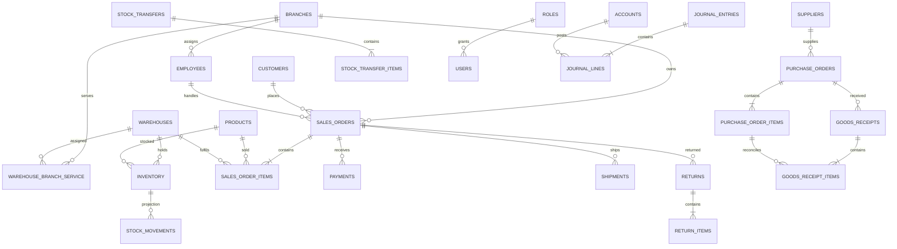
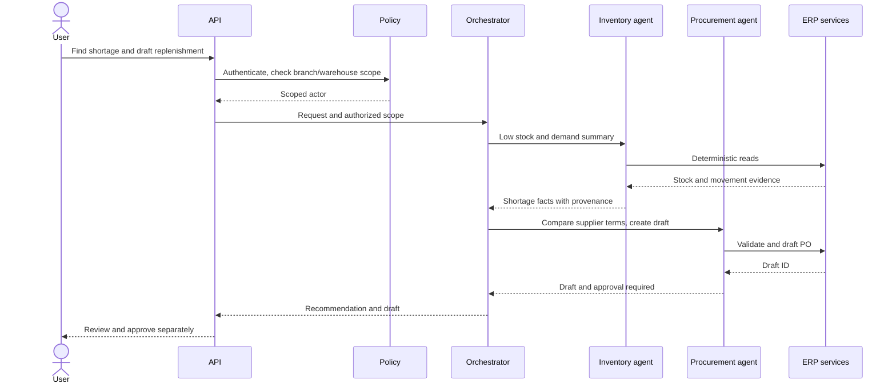
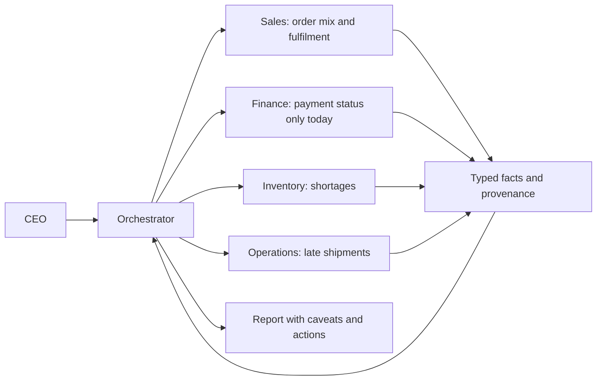

# Dataset Audit and Agentic ERP Implementation Plan

> **Baseline report:** this audit describes the original `out/` dataset as it stood before the corrections made on 2026-10-28. For the regenerated, corrected dataset and validation results, see [DATA_REPAIR_REPORT.md](DATA_REPAIR_REPORT.md).

**Scope.** This report analyzes the 26 CSV data tables in `out/`, `schema.sql`, the data dictionary, generator documentation and `out/validation_report.txt`. Record counts/statistics were computed from the present CSVs. The supplied report says it was generated 2026-10-18 with seed `20240101` and reports 83/83 checks passing. The CSVs were not modified. All records are synthetic.

## 1. Dataset Structure Report

### Files, tables and records

Types below follow the PostgreSQL declarations in `schema.sql`: identifiers and quantities are integer (movement ID is BIGINT); money is NUMERIC(14,2); dates/timestamps are DATE/TIMESTAMPTZ; flags are BOOLEAN; rates are numeric; descriptive fields are VARCHAR/TEXT. CSV itself does not enforce types, so import using the SQL schema.

| File/table | Rows | Entity and main links |
|---|---:|---|
| branches | 6 | Branch master |
| warehouses | 3 | Stock locations; nullable branch link |
| employees | 120 | Branch, optional warehouse/manager, department text |
| roles | 7 | Role catalog |
| permissions | 19 | Permission catalog |
| role_permissions | 57 | Role-permission bridge |
| users | 37 | Employee login and role; fake password placeholder |
| product_categories | 40 | Hierarchy; 8 roots and 32 children |
| products | 500 | SKU, category, prices, reorder data |
| suppliers | 20 | Supplier, terms, lead-time and rating |
| supplier_products | 1,308 | Supplier/product cost and lead-time bridge |
| customers | 300 | Individual/business customer master |
| sales_orders | 10,000 | Branch/customer/employee and totals/status |
| sales_order_items | 40,559 | Product, fulfilment warehouse, quantity/pricing |
| payments | 9,487 | Order-linked payment status and amount |
| shipments | 9,099 | Order/warehouse/carrier and delivery timeline |
| returns | 284 | Order/customer/warehouse return header |
| return_items | 592 | Returned line, condition and disposition |
| inventory | 1,398 | Current quantity per warehouse/product |
| stock_movements | 41,994 | Signed inventory ledger with source reference |
| stock_transfers | 200 | Transfer header, endpoints and state |
| stock_transfer_items | 420 | Requested/shipped/received quantities |
| purchase_orders | 500 | Supplier, destination warehouse, totals/state |
| purchase_order_items | 8,523 | Product and ordered/received quantities |
| goods_receipts | 457 | Receiving event against PO |
| goods_receipt_items | 7,766 | Product quantities received against PO lines |

The history spans 2023-01-01 through 2023-12-31. All order currencies are USD. Empty fields found are mostly optional or conditional: individual vs business customer names, employee warehouse/manager/termination fields, cancelled timestamp for non-cancelled orders, approval users, delivered/receipt metadata and notes. `supplier_products.valid_to` is empty for every record. `sales_orders.notes`, `purchase_orders.notes`, and `stock_transfers.notes` are empty in all rows.

The complete source column inventory is below; exact SQL types, nullability, defaults and constraints are defined per column in `schema.sql` (the inventory is not merely inferred from CSV values).

| Table | Columns in source order |
|---|---|
| branches | branch_id, branch_code, name, branch_type, address_line, city, region, country, phone, email, opened_date, is_active, created_at, updated_at |
| warehouses | warehouse_id, warehouse_code, name, warehouse_type, branch_id, address_line, city, region, country, capacity_units, is_active, created_at, updated_at |
| employees | employee_id, employee_code, branch_id, warehouse_id, first_name, last_name, email, phone, job_title, department, hire_date, termination_date, manager_id, is_active, created_at, updated_at |
| roles | role_id, role_name, description, created_at |
| permissions | permission_id, permission_key, description |
| role_permissions | role_id, permission_id |
| users | user_id, username, email, password_hash, employee_id, role_id, is_active, last_login_at, created_at, updated_at |
| product_categories | category_id, category_code, name, parent_category_id, description, is_active, created_at, updated_at |
| products | product_id, sku, name, category_id, description, unit_of_measure, cost_price, list_price, reorder_point, reorder_quantity, safety_stock, weight_kg, is_active, created_at, updated_at |
| suppliers | supplier_id, supplier_code, name, contact_name, email, phone, address_line, city, country, payment_terms, default_lead_time_days, rating, is_active, created_at, updated_at |
| supplier_products | supplier_product_id, supplier_id, product_id, supplier_sku, unit_cost, lead_time_days, min_order_qty, is_preferred, valid_from, valid_to, created_at |
| customers | customer_id, customer_code, customer_type, first_name, last_name, company_name, email, phone, address_line, city, region, country, loyalty_tier, credit_limit, registration_date, is_active, created_at, updated_at |
| sales_orders | sales_order_id, order_number, branch_id, customer_id, employee_id, order_date, status, channel, subtotal, discount_amount, tax_amount, shipping_amount, total_amount, currency, notes, cancelled_at, created_at, updated_at |
| sales_order_items | sales_order_item_id, sales_order_id, line_number, product_id, warehouse_id, quantity, quantity_fulfilled, unit_price, discount_rate, tax_rate, line_subtotal, line_total, created_at |
| payments | payment_id, payment_number, sales_order_id, payment_date, amount, method, status, reference, created_at |
| shipments | shipment_id, shipment_number, sales_order_id, warehouse_id, carrier, tracking_number, shipped_date, promised_date, delivered_date, status, shipping_cost, created_at, updated_at |
| returns | return_id, return_number, sales_order_id, customer_id, warehouse_id, return_date, reason, status, refund_amount, created_at, updated_at |
| return_items | return_item_id, return_id, sales_order_item_id, product_id, quantity, unit_price, line_refund, item_condition, disposition, created_at |
| inventory | inventory_id, warehouse_id, product_id, quantity_on_hand, quantity_reserved, reorder_point, last_counted_at, updated_at |
| stock_movements | movement_id, warehouse_id, product_id, movement_type, quantity_change, balance_after, reference_type, reference_id, unit_cost, movement_date, notes, created_at |
| stock_transfers | transfer_id, transfer_number, source_warehouse_id, destination_warehouse_id, requested_by, approved_by, request_date, status, dispatched_date, received_date, expected_date, total_quantity, reason, notes, created_at, updated_at |
| stock_transfer_items | transfer_item_id, transfer_id, product_id, quantity_requested, quantity_shipped, quantity_received, unit_cost, created_at |
| purchase_orders | purchase_order_id, po_number, supplier_id, warehouse_id, requested_by, approved_by, status, order_date, expected_date, subtotal, tax_amount, shipping_amount, total_amount, currency, notes, created_at, updated_at |
| purchase_order_items | po_item_id, purchase_order_id, line_number, product_id, quantity_ordered, quantity_received, unit_cost, line_total, created_at |
| goods_receipts | receipt_id, receipt_number, purchase_order_id, warehouse_id, received_by, received_date, status, notes, created_at |
| goods_receipt_items | receipt_item_id, receipt_id, po_item_id, product_id, quantity_received, unit_cost, line_total, created_at |

### Actual organization and relationships

Six US branches: HQ (`HQ`, Springfield/Central Region), Riverton (`BR001`, North), Lakeside (`BR002`, East), Fairview (`BR003`, West), Oakdale (`BR004`, South), Brookfield (`BR005`, Coastal).

| Warehouse | Type | Branch FK | Location |
|---|---|---|---|
| Central Distribution Center (`WH-CENTRAL`) | central | HQ | Springfield |
| Riverton Regional Warehouse (`WH-R01`) | regional | null | Riverton |
| Lakeside Regional Warehouse (`WH-R02`) | regional | null | Lakeside |

Regional warehouse cities align to Riverton/Lakeside, but the CSV does not declare that association. Three branches have no dedicated warehouse record. Do not infer warehouse authorization or branch stock ownership from city alone. Employee departments are free text: Warehouse 44, Sales 33, Finance 14, IT 10, Management 10, Procurement 9. Branch employee counts: HQ 19, Riverton 20, Lakeside 24, Fairview 18, Oakdale 23, Brookfield 16. The 37 users have roles: warehouse_manager 11, branch_manager 10, sales_agent 8, finance_officer 3, procurement_officer 2, admin 2, ai_agent_service 1. The README explicitly describes password hashes as non-functional synthetic placeholders.

### Supported business processes and gaps

Existing records support synthetic analysis of order and product mix, branch order value, shipment delays, payment status, returns, purchase orders, supplier terms, receipt completeness, inventory balances/ledger history, and inter-warehouse transfer history. The dataset lacks GL journals, chart of accounts, invoices/credit notes, expenses, tax remittance, cash/bank reconciliation, payroll/compensation, projects, production/BOMs, service cases and fixed assets. Therefore it cannot support audited revenue, profit, balance sheet, cash flow, payroll cost or project/production margin. Order total is a commercial amount, not recognized accounting revenue.

## 2. Data Quality Audit

### Confirmed findings

The supplied validation report passes 83 selected checks covering counts, selected FKs/uniqueness, sales and PO arithmetic, stock-ledger reconciliation, transfer lifecycle, selected chronology and scenario presence. It is dated and must be rerun against the actual import target. Independent CSV checks confirmed all 26 row counts, no absent order lines, no mismatch in examined return customer/product links, PO supplier/product links, receipt warehouse/PO destination, receipt item/PO item product, and no break in chronological `balance_after` movement chains.

| Finding | Evidence | Severity and effect |
|---|---|---|
| Sales employee belongs to another branch | 8,353/10,000 orders have `sales_orders.branch_id != employees.branch_id` for their `employee_id`. Example: `SO-202310-0000001` has order branch 5 and employee 116 in branch 2. | **High.** Misattributes sales activity and breaks branch manager access, commission and reporting. Supplied validator misses it. |
| Warehouse service-area relationship is missing | Two regional warehouses have null `branch_id`; only central is associated with HQ. Three branches lack their own warehouse. | **High.** Unsafe branch stock visibility and transfer/fulfilment decisions. |
| Finance unsupported | No GL, expenses, invoices, COGS or accounting subledger. | **High.** Profitability/accounting workflows must not infer profit from order totals. |
| Payment lifecycle is synthetic and narrow | 4,609 `completed`, 4,878 `pending`; every delivered order has one completed payment and dispatched/pending orders with payment have pending. No failed/refunded payment rows. Completed sum $7,070,163.48; pending sum $12,514,889.51. | **Medium.** Does not represent settlement, partial payments, failures, refunds or credit collections. Pending is not cash. |
| Low-stock / stockout-heavy distribution | 1,398 pairs: 320 at zero; 1,074 at or below reorder point including zero; 72 above 3x reorder. Validator reports 388 wholly unfulfilled pending orders. | **Medium.** Useful stress-test scenario, but service level is 77.4% by ordered units (73,562/94,993); do not present as normal retail performance without qualification. |
| Branch “revenue” can be overstated | Total order value is $20,589,835.04; orders include delivered, dispatched, pending and cancelled states. | **High if called revenue.** Report order value by status; cancelled and pipeline values are not recognized revenue. |
| Department is denormalized | Six values in `employees.department`; no department table, cost center or assignment history. | **Medium.** Limits org, HR and cost reporting. |

Other actual metrics: branch order counts: HQ 1,337; Riverton 1,946; Lakeside 1,798; Fairview 1,453; Oakdale 1,288; Brookfield 2,178. Inventory pairs by warehouse: central 495, Riverton 455, Lakeside 448. Stock movement sums reconcile with current on-hand per the supplied validator. Receipt totals reconcile to PO lines. These indicate internal synthetic consistency, not realism.

### Suspicious / unknown, not confirmed defects

- Product prices, seasonality, customer behavior and supplier lead times are generated patterns; they do not establish realistic commercial behavior. Product list price was not below cost in inspected rows, but that is not gross margin.
- `quantity_reserved` has no reservation/allocation ledger in the supplied files; the validator does not reconcile it to open orders.
- `supplier_products.valid_to` is null throughout: could mean current terms or missing expiry information; this is unknown.
- Transfer states: 103 completed, 56 rejected, 21 pending, 11 cancelled, 9 approved; no in-transit transfer, despite schema support. Shipment has 4,609 delivered and 4,490 in-transit rows.
- Employee/branch mismatch may result from generator logic. Replacing employee IDs without a review can rewrite history incorrectly.

### Non-destructive correction plan

| Priority and location | Correction / method |
|---|---|
| P0 orders.employee_id vs employees.branch_id | Export all 8,353 mismatches with current IDs and branch values; review a deterministic employee mapping (or permit null/system-origin only if policy supports it). Correct only a staging copy with before/after audit rows. Fix generator to select from the order branch. |
| P0 warehouses.branch_id/service coverage | Obtain approved service-area mapping. Model effective-dated many-to-many warehouse/branch service, with fulfilment and transfer flags. Do not guess mapping from location. |
| P0 finance | Add source-backed accounting data before making finance/profitability claims. Preserve orders and payments as operational facts; do not fabricate journal entries. |
| P1 reservations | Add order reservation header/lines; derive reserved quantity from active reservations and reconcile projection. |
| P1 missing validation | Extend checks to every PK/FK/unique/check plus employee/branch, warehouse/service area, reservation, payment allocation, returns/refunds, status transitions. |
| P1 department / HR | Preserve department text as a source label; normalize department, position, effective-dated assignment and cost center if required. Payroll needs independent source data. |
| P2 scenario realism | Review generated pricing/demand/time distributions against intended test objectives; add periods/scenarios only when useful. Keep provenance. |

Keep original CSVs unchanged, record hashes, import raw → staging → canonical, and log each correction with source value, new value, reason, batch, and approver. Preserve valid IDs, transaction amounts, movement/receipt history and timestamps unless source-backed review proves otherwise.

## 3. PostgreSQL Database Architecture

Keep the existing 26 tables as the operational seed model, but evolve production schema via Alembic; never run the current `DROP SCHEMA ... CASCADE` reset script in production. Use PostgreSQL 16+, `NUMERIC` for money, UTC `TIMESTAMPTZ`, explicit currency/UOM, UUIDs for newly-created live entities (retain integer IDs as source keys during migration), append-only movement and audit ledgers. Add tenant key only if future independent companies are required; the files show one synthetic company.

| Module | Target entities / rules |
|---|---|
| Organization/access | `departments`, `positions`, effective-dated `employee_assignments`, `warehouse_branch_service`, `user_branch_scope`, `user_warehouse_scope`, `audit_events`, `agent_runs`, `agent_tool_calls`. Roles grant capabilities; scopes separately restrict rows. |
| Catalog | UOM, tax category, barcode/alternate SKU, effective-dated price lists. Enforce non-overlapping active supplier/product terms. |
| Sales | Existing order/line/payment/shipment/return plus `order_status_events`, `order_reservations`, `reservation_lines`, invoices/lines, credit notes, payment allocations, shipment lines. Validate positive quantities, branch/employee/service-area compatibility and payment allocation bounds. |
| Inventory | Existing immutable `stock_movements` and current projection plus reservations, cycle counts, optional lot/serial and valuation layers. Transfer status events, separate in-transit inventory and partial receipt/loss support. |
| Procurement | Existing PO/lines/receipts plus approvals, supplier invoices/lines and three-way match results. Validate receipt line product and warehouse against PO. |
| Finance | `legal_entities`, `fiscal_periods`, `accounts`, `journal_entries`, `journal_lines`, `tax_codes`, AR/AP invoices/lines, payment allocations, bank statement lines/reconciliations and cost centers. Posted journals balance by currency and are reversed, not edited. |
| HR / operations | Positions, assignments, pay periods/runs/lines only when policy/source exists. Projects, work orders, BOM/production, service requests and fixed assets are unsupported by present data and require discovery first. |
| Security/workflow | `approval_policies`, `approval_requests`, `approval_decisions`, `idempotency_keys`, `outbox_events`, scoped API identities. Separate agent and human identities. |

**Rules and performance.** Warehouse/branch service is many-to-many and effective-dated. `inventory` is keyed by `(warehouse_id, product_id)`; available = on-hand less active reservation. Movement insert and balance projection update occur in one transaction, locking stock rows. Transfer dispatch decrements source into in-transit; receipt increments destination; discrepancy requires an adjustment reason. Persist source facts and charged rounded line totals; derive availability, outstanding balance and KPIs. Add FK indexes; unique SKU/order/PO/transfer numbers, `(warehouse_id,product_id)`, `(order_id,line_number)`; indexes for branch/date, warehouse/product/movement date, supplier/status/date, order payments, open due dates; partial indexes for active reservations/open orders. Partition high-volume ledger/audit tables only after measurement. Views: `v_inventory_position`, `v_order_fulfilment`, `v_open_purchase_orders`, `v_receivables_aging`, status-labelled daily branch order value. Materialize analytics only when measured useful. Use row locks or serializable retry for inventory writes, idempotency keys and transactional outbox.



## 4. ERP Module Coverage Matrix

| Module | Data support | Action |
|---|---|---|
| Organization/branch/warehouse | Partial; warehouse service map incomplete | Resolve mapping first |
| User/roles/permissions | Partial synthetic RBAC data; no implemented auth/scopes | Implement scoped auth; discard fake hashes |
| Products/categories | Supported basic catalog | Add UOM/tax/history as needed |
| Sales/customer/orders | Supported operational analysis | Add invoice/accounting for recognized revenue |
| Fulfilment/shipping | Partial: shipment lifecycle exists; service rules absent | Add service-area and fulfilment events |
| Inventory/transfers | Strong ledger/current balance; reservations untraced, 3 warehouses | Add reservation and in-transit model |
| Procurement/receiving | Strong synthetic PO/receipt history | Add approvals and invoice matching |
| Finance/accounting | Unsupported except commercial totals/payment status | Build from reliable source facts |
| HR/payroll | Employee roster and free-text department only | HR partial, payroll unsupported |
| Project/production/service | No records | Unsupported pending requirements |
| Analytics | Supported for synthetic orders/stock/procurement | Label metrics; no audited profit |
| Audit trail | Timestamps only, no event history | Add append-only audit/state events |

## 5. Complete Multi-Agent Architecture

Use OpenAI Agents SDK for language interpretation, bounded routing and summaries. All calculations and writes use deterministic typed Python services. The orchestrator authenticates caller context, checks scopes, invokes domain agents, validates outputs and assembles results with query provenance. No arbitrary SQL or direct agent DB access.

| Agent | Responsibilities/tools | Boundary |
|---|---|---|
| CEO/orchestrator | Interpret, coordinate, summarize, cite evidence | No direct DB/write access |
| Sales | Branch order value, top products, customer/order patterns, channel mix, returns, fulfilment | Read-only; status-labelled and branch-scoped |
| Inventory | Warehouse stock, low stock, ledger, turnover, transfer recommendation | Read-only; transfer drafts only |
| Procurement | Supplier performance/quotes, replenishment, PO draft | Draft/submit only; spend approval external |
| Finance | Payment status now; AR/expense/margin/journal only after finance data exists | Finance scopes; no posting |
| HR | Employee distribution and staffing aggregates | PII-minimized; payroll disabled absent data |
| Fulfilment/operations | Open orders, lateness, capacity, pick/ship drafts | Execute only via authorized command and approval |
| Customer service | Customer order status, return eligibility, return draft | PII-minimized; refunds require policy |
| Policy/authorization service | `authorize(actor, action, branch, warehouse, amount)`, redaction and approval | Deterministic, mandatory, default deny |

Prefer orchestrator-controlled calls for multi-domain work; bounded handoffs for specialist requests. Use Pydantic schemas, timeouts, max tool calls/turns and model/tool version logging. Approval is a separate human workflow, never model self-approval.

## 6. Tool Catalogue

All tools accept authenticated actor context from API (never user-supplied scopes), call parameterized SQL/services, and return typed outputs.

| Function | Inputs/output; tables | Mode and controls |
|---|---|---|
| `get_branch_sales` | Branch/date/status → daily/product totals; orders/lines | Read; authorize branch; call order value, not revenue |
| `get_company_order_value` | Date/status filter → totals; orders | Read; separate cancelled/pipeline states |
| `get_top_products` | Period/scope/metric → ranking; orders/lines/products | Read; deterministic tie-break |
| `get_customer_order_history` | Customer/period → minimal order summary | Read; PII restricted/redacted |
| `get_warehouse_stock` | Warehouse/product → on-hand/reserved/available | Read; warehouse scope and snapshot time |
| `get_low_stock_products` | Scope/threshold policy → candidate shortages | Read; threshold provenance; include zero stock |
| `calculate_inventory_turnover` | Scope/period/basis → ratio and inputs | Read; disable value basis until valuation/COGS exists |
| `recommend_stock_transfer` | Route/horizon → candidate qty and rationale | Read-only recommendation; include reserve/safety stock |
| `create_transfer_draft` | Route, lines, reason, idempotency → draft ID | Draft write; validate stock/service area/actor |
| `analyze_supplier_performance` | Supplier/period → lead time, completeness, cost | Read; distinguish observations from SLA |
| `create_purchase_order_draft` | Supplier, warehouse, lines, currency → draft | Draft; supplier term/minimum/price validation |
| `submit_po_for_approval` | PO ID → approval request | State change; no self-approval; threshold enforced |
| `get_order_payment_status` | Order ID → completed/pending/outstanding | Read; pending is not settled cash |
| `get_employee_distribution` | Grouping/scope → aggregates | Read; suppress PII/small groups |
| `get_late_shipments` | Period/scope → lateness summary | Read; promised-vs-delivered definition explicit |
| `create_return_case_draft` | Order/line/qty/reason → draft | Draft; eligibility, prior returns, customer scope |
| `generate_executive_report` | Period/scopes → facts/actions/provenance | Orchestrates read tools; disclose missing GL |

Validate dates, page size, IDs, quantities, currencies, transitions, amount limits and idempotency. Return stable `not_found`, `forbidden`, `conflict`, `validation_error`, `retryable` errors without leaking SQL or cross-scope existence.

## 7. Cross-Agent Workflows

### Replenishment with approval



### Branch performance report



Current data supports order-value, payment-status, inventory and delivery comparisons, not branch profitability. Warehouse transfer recommendation: read service map and authorized scopes; compute available after reservations and safety stock; explain unknown capacity/freight; create draft; approval; dispatch to in-transit; receipt posts destination stock; losses require explicit adjustment. Executive report should disclose the synthetic one-year window and absence of GL; never claim net income.

## 8. Backend, Frontend, Security and Reliability

**Stack:** Python 3.12, FastAPI, Pydantic v2, SQLAlchemy 2, Alembic, PostgreSQL 16+, OpenAI Agents SDK, Docker, OpenTelemetry-compatible tracing and structured logs. React + TypeScript is recommended for ecosystem, typed API contracts, data grids/charts and independent frontend iteration. n8n is suitable for noncritical notifications/import schedules, not transaction processing.

```text
app/{api/v1,core,db,schemas,services,agents,jobs,integrations,observability}/
frontend/ (React + TypeScript)
tests/{unit,integration,security,agent_eval}/
migrations/
infra/{docker,compose,deploy}/
docs/{adr,api,runbooks,data}/
```

API: `POST /v1/agent-requests`, `GET /v1/agent-requests/{id}`, read endpoints for branches/warehouses/inventory/sales/procurement/shipments/payment status/HR aggregates, draft endpoints for transfers/POs/returns, and approval approve/reject endpoints with version and idempotency key. Background workers handle long reports, import, reconciliation and outbox. Services re-check permission inside write transactions. Use OIDC/SSO; RBAC grants actions while explicit branch/warehouse scopes constrain rows. Optional PostgreSQL RLS is defense in depth, not sole authorization.

Prompt inputs, imported notes and customer content are untrusted data. Minimize/redact PII, prohibit LLM SQL, validate tool schemas, rate-limit requests and cap turns/tool calls. Runtime DB roles use least privilege; agents do not hold schema-owner credentials. Audit actor, request, agent/model/tool versions and redacted arguments. Require human approval for high-spend PO, write-off, transfer dispatch, refund, journal post, permission/HR changes. Use separation of duties, row locks, idempotency, transactional outbox, bounded retries, circuit breakers, secret manager, encryption, retention rules and backups.

## 9. Two-Developer Roadmap

Efforts are person-weeks, excluding business-decision latency. A leads data/database/backend; B leads API/agents/UI; both review security. Estimated total 20–29 person-weeks (about 10–15 calendar weeks for two developers with overlap).

| Phase | Work / owner | Dependencies and parallelism | Estimate / acceptance |
|---|---|---|---|
| 1 Inspect | A profile all files/links; B review generator/schema and gap register | Parallel, none | 1 pw; verified inventory and unknowns labelled |
| 2 Correct/enrich | A staging validators/employee exception map; B obtain branch/warehouse and finance decisions | Phase 1 | 1–2 pw; no overwrite, traceable correction plan |
| 3 DB design | A ERD, transaction and ledger migrations; B API/schema and permission contracts | 1–2 | 2 pw; signed schema and scope rules |
| 4 Migration | A staging import/reconciliation; B verification views/runbook | 3 | 1–2 pw; repeatable import and integrity pass |
| 5 Core services | A catalog/sales/inventory/procurement; B auth, scopes, approvals, audit/API | 3–4, parallel | 3–4 pw; atomic stock commands and scoped reads |
| 6 Tools | A deterministic typed tools; B registry/provenance/error mapping | 5 | 1.5–2 pw; tools only call services |
| 7 Domain agents | A inventory/procurement/operations; B sales/finance facts/HR aggregate/customer service | 6 | 2–3 pw; bounded typed agents |
| 8 Orchestrator | A+B routing, typed aggregation, budgets and tracing | 7 | 1–2 pw; evidence-backed scoped output |
| 9 Workflows | A replenish/transfer; B performance/return workflows | 8 | 2 pw; end-to-end drafts and separate approval |
| 10 Hardening | A concurrency/idempotency/DB roles; B injection, redaction, scope tests | Continuous after 5 | 1.5–2 pw; negative cases denied and audited |
| 11 Dashboard | B React views/approval inbox; A API pagination/performance | 5–9 | 3–4 pw; user can inspect evidence and act within scope |
| 12 Evaluation | A DB/service/concurrency; B agent/workflow/unsupported-claim eval | 5–11 | 2–3 pw; gates below pass |
| 13 Deploy | A images/migrations/backup; B CI/CD/env/docs | 5–12 | 1–2 pw; staging deploy and restore demonstrated |
| 14 Monitor/docs | A reconciliation/metrics/runbooks; B operator guide/eval report | 13 | 1–2 pw; freshness, audit and on-call signals |

Critical path: business mapping → schema/migrations → import → authorization/domain services → tools → agents/orchestrator → workflow → evaluation/security → deployment. Frontend starts after API/auth contracts. Payroll/accounting UI waits for data and policies.

## 10. Testing and Agent Evaluation

Acceptance criteria for implementation:

1. Each file hash/count/header/null profile and import batch recorded; rejected rows quarantined.
2. All PK/FK/unique/check rules pass; source/target counts match except approved corrections.
3. Sales arithmetic reconciles to cents; cancelled order value is not recognized revenue; allocated payment never exceeds captured amount.
4. Inventory projection equals ledger; on-hand ≥ reserved ≥ 0; concurrent reservation cannot oversell; idempotent retry creates one movement.
5. PO received totals equal receipts; supplier, warehouse, product and line links consistent; approval/three-way match enforced.
6. Transfer lifecycle and stock movement are atomic and authorized; partial receipt/loss traceable; pending/rejected states post no stock.
7. Employee assignment, warehouse service area and branch/warehouse scope tested; forbidden calls reveal no data.
8. RBAC, approval thresholds, separation of duties, PII redaction and prompt injection have negative tests.
9. Agent request routing ≥95% on curated cases; valid tool args ≥99%; unsupported financial claim rate 0; deterministic totals match service output 100%; provenance included.
10. End-to-end fixtures: Riverton shortage with excess source; supplier comparison/PO draft; late shipment; damaged return not restocked; cross-branch access denied; quarterly report says GL/profit unavailable.

The supplied validator is a useful base but is not a full schema/business test. Do not execute/add tests during this audit; these are implementation acceptance requirements.

## 11. Immediate Action Plan

1. Freeze current CSVs; record hashes, counts, seed and validator report.
2. Build a read-only CSV validation pass for every declared constraint and cross-file rule; emit row-level exceptions.
3. Review the 8,353 employee/branch exceptions; correct generator selection and stage an approved mapping.
4. Obtain warehouse service map and model branch/warehouse many-to-many.
5. Agree definitions for order value, recognized revenue, pending payment and refunds.
6. Decide GL/AP/AR/payroll/projects/production scope; require source evidence before agent enablement.
7. Build canonical schema/migrations and import provenance; keep source IDs as source keys.
8. Implement deterministic services and authorization before Agents SDK tools.

## 12. Prioritized Checklists

### Checklist A — Dataset corrections before development

- [ ] Preserve immutable CSVs and hashes.
- [ ] Review/correct 8,353 employee-branch mismatches in staged data and fix generator.
- [ ] Approve warehouse/branch service map and add effective-dated many-to-many relation.
- [ ] Reconcile reserved quantities to explicit order allocations.
- [ ] Define payment, shipment, return and revenue lifecycle; keep fixtures labelled.
- [ ] Extend validation across all constraints and business links.
- [ ] Decide finance/HR/project scope; do not infer unsupported profit/payroll.
- [ ] Log all changes; leave originals untouched.

### Checklist B — Complete Agentic ERP components

- [ ] PostgreSQL canonical model, migrations, staging import and reconciliation.
- [ ] Organization/catalog/sales/inventory/transfer/procurement/receipt services.
- [ ] Finance ledger/invoices before accounting agents; HR/payroll only with data.
- [ ] Authentication, role and branch/warehouse scopes, audit trail.
- [ ] Approval engine, separation of duties, idempotency and outbox.
- [ ] Typed deterministic tools, domain agents, orchestrator and provenance.
- [ ] FastAPI, background jobs, React dashboard and Docker deployment.
- [ ] Monitoring, backups, runbooks and data/security/concurrency/agent evaluation.

### Checklist C — Development sequence

- [ ] Hash/profile source and confirm schema.
- [ ] Resolve employee and warehouse mappings.
- [ ] Agree module scope and business definitions.
- [ ] Design ERD, scopes, states and migrations.
- [ ] Build staging import, validation and correction history.
- [ ] Implement identity, authorization, audit and approval.
- [ ] Implement deterministic domain services and API.
- [ ] Build dashboard read flows.
- [ ] Build typed agent tools and domain agents.
- [ ] Implement orchestrator and cross-domain workflows.
- [ ] Pass integrity, security, concurrency and unsupported-claim gates.
- [ ] Deploy with monitoring, backup/restore and operator documentation.
